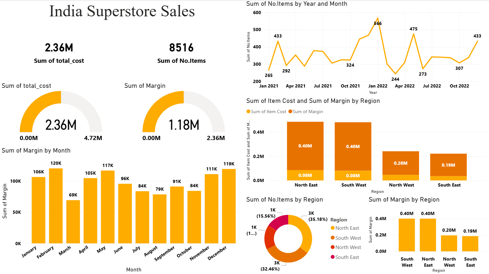
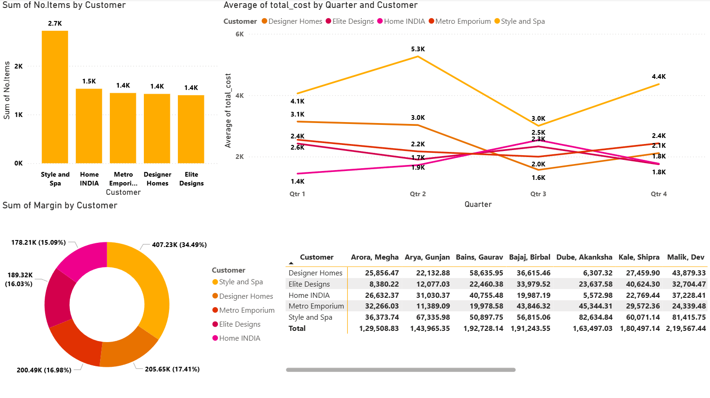
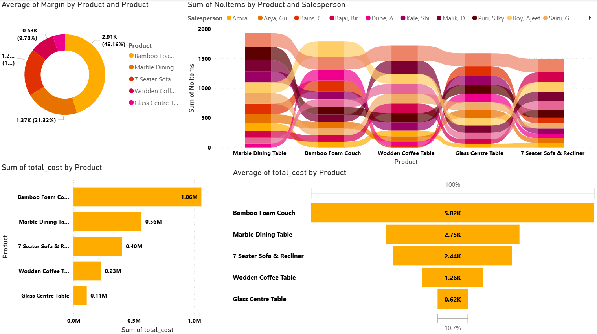

# 🛒 India Superstore Sales Analysis Dashboard

## 📌 Project Overview

This project features an interactive **Power BI dashboard** developed to explore and evaluate India Superstore sales data.

The dashboard highlights important business metrics and helps understand revenue patterns, profitability, customer purchasing trends, and product performance.

---

## 📊 Dashboard Screenshots

### 🔹 Page 1 – Overall Sales Performance

### 🔹 Page 2 – Customer Insights

### 🔹 Page 3 – Product Performance

---

## 🔍 Business Insights

- Generated total sales exceeding **2.36M**.
- Examined profit distribution across different regions and product categories.
- Evaluated monthly sales growth and profit margin variations.
- Identified individual customer contributions to overall revenue.
- Compared product-level performance to understand sales patterns.

---

## 🛠 Technologies & Skills Applied

- Microsoft Power BI
- Data Preparation & Cleaning
- Interactive Data Visualization
- Business Intelligence & Reporting
- DAX (Data Analysis Expressions)

---

## 🎯 Dashboard Capabilities

- Dynamic slicers and interactive filtering options.
- KPI indicators for Sales, Items, and Profit Margins.
- Detailed regional and customer-level performance analysis.
- Three-page dashboard for exploring different business perspectives.

---

## 🚀 Potential Enhancements

- Implement time-series forecasting to estimate future sales.
- Incorporate Python for deeper statistical and predictive analysis.
- Develop a web-based version to make dashboard insights accessible online.